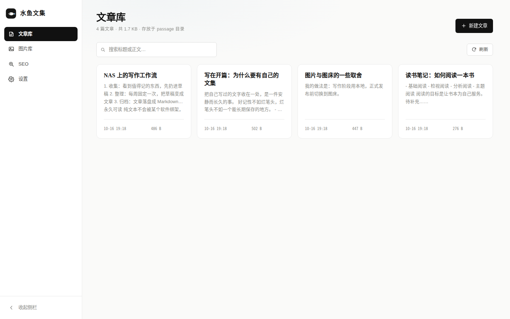
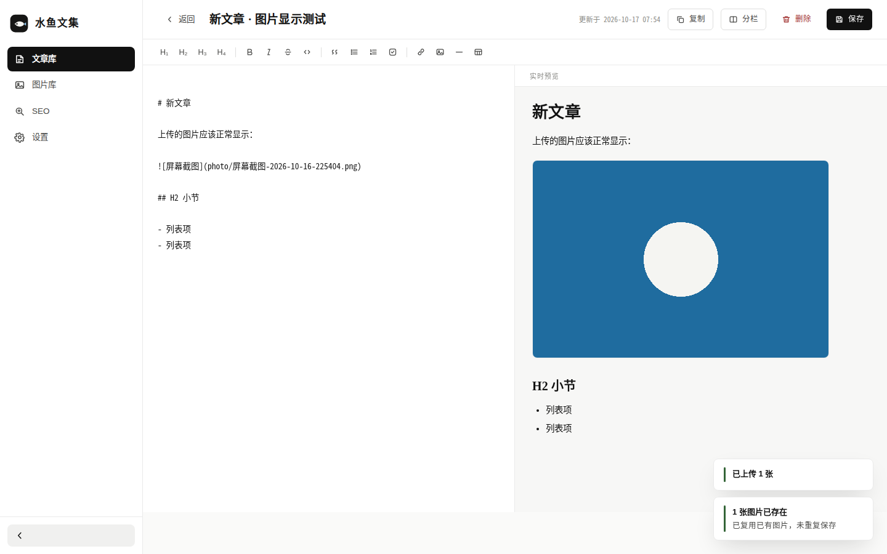
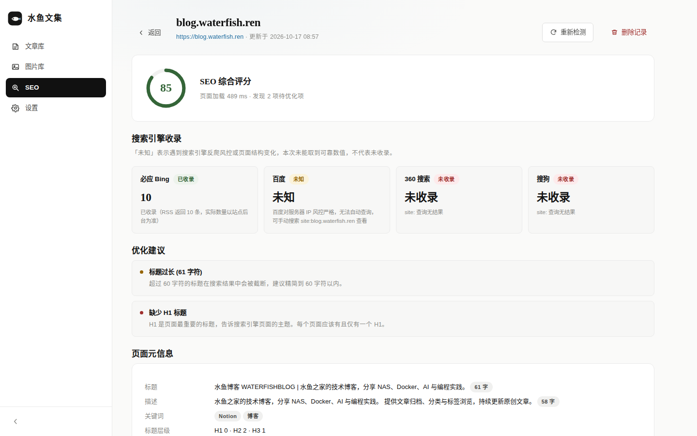
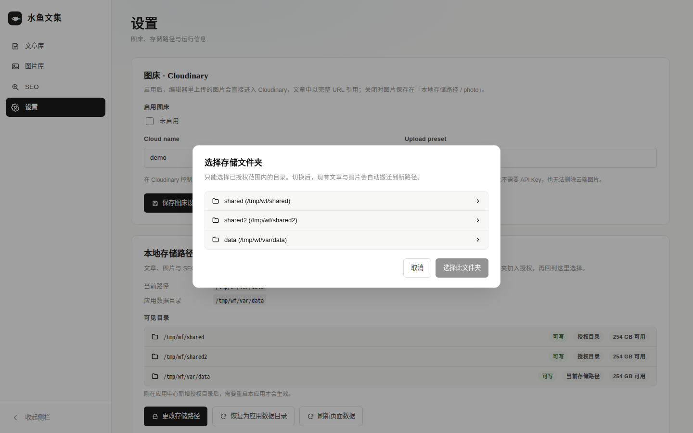
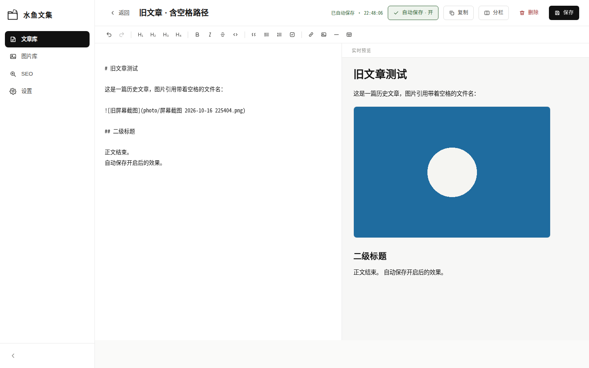
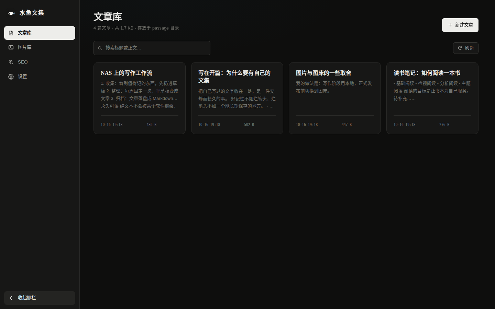
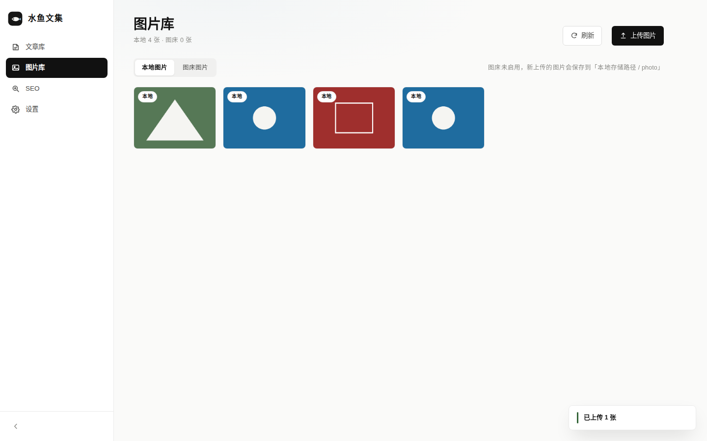
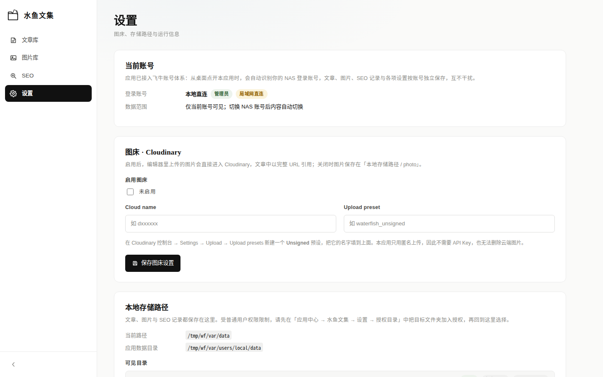

# 水鱼文集 · waterfish_anthology

面向飞牛 fnOS 的**原生应用**（第三方），以普通用户权限运行。把写过的文字收在一处：
Markdown 文章库、本地 / 图床双通道图片库、SEO 检测与自定义存储路径。
接入飞牛统一网关，桌面图标点开即用（NAS 账号免登），各账号数据独立。

```
┌──────────┐  文章库   列出 / 新建 / 编辑（撤销重做 · 代码块 · 每篇可开自动保存）/ 复制 / 删除
│ 水鱼文集 │  图片库   本地图片（可删） + 图床图片（复制 URL）
│ ▸ 文章库 │  SEO      页面体检 + 必应/百度/360/搜狗收录查询，可反复查看
│ ▸ 图片库 │  设置     账号 / 外观（主题打包 · 自定义 JS）/ 管理员设置（图床 · 存储）/ 更新与实验 / 关于
│ ▸ SEO    │
│ ▸ 设置   │
└──────────┘
```

| 文章库 | 编辑器 |
| --- | --- |
|  |  |

| SEO 检测 | 存储路径授权 |
| --- | --- |
|  |  |

编辑器（撤销 / 重做 · 代码块 · 每篇文章独立的自动保存）：



深色主题、图片库、应用图标与账号卡片：






---

## 一、架构

| 层 | 选型 | 说明 |
| --- | --- | --- |
| 后端 | **Go 1.21，纯标准库** | 单个静态二进制，`CGO_ENABLED=0` 交叉编译，NAS 上零运行时依赖 |
| 前端 | **原生 ES Module + 手写 CSS** | 无 npm 构建链，`go:embed` 打包进二进制；Markdown 渲染用内置的 marked |
| 打包 | **fnpack 1.2.3** | 官方工具，产出 `x86` / `arm` 两个 `.fpk` |
| 权限 | `config/privilege` → `run-as = package` | 专用包用户运行，非 root |

> 之所以刻意不用任何第三方 Go 依赖：NAS 环境常常无法访问 Go 模块代理，纯标准库可以让 `go build` 在任何离线机器上一次通过。

### 目录结构

```
waterfish_anthology/
├── build.sh                    一键构建（x86 + arm 两个 fpk）
├── src/                        Go 后端 + 前端资源
│   ├── main.go                 服务入口、路由、静态资源
│   ├── app.go                  配置读写、路径校验、环境变量
│   ├── articles.go             文章库：frontmatter 解析、CRUD、复制
│   ├── images.go               图片库：本地图片、图床索引、上传
│   ├── cloudinary.go           Cloudinary unsigned 上传
│   ├── seo.go                  SEO 检测与收录查询
│   ├── user.go                 每用户视图：登录身份解析、配置隔离、历史数据继承
│   ├── editorstate.go          编辑器状态：自动保存开关与撤销栈的读写
│   ├── theme.go                外观配置清洗与自定义主题脚本下发
│   ├── settings.go             存储路径切换与迁移、目录浏览、外观保存
│   ├── docs/theme-guide.md     外观主题定制说明（内置主题 + 自定义 JS）
│   └── web/                    前端（index.html / style.css / app.js / editor.js / views/）
├── packaging/                  fpk 骨架
│   ├── manifest                应用元数据
│   ├── ICON.PNG ICON_256.PNG   包图标（64 / 256）
│   ├── app/ui/                 桌面入口配置与入口图标
│   ├── cmd/                    生命周期脚本
│   ├── config/                 privilege / resource
│   ├── wizard/                 install / config / uninstall 向导
│   ├── icon.svg                图标源文件
│   └── make-icons.py           由 icon.svg 生成各尺寸 PNG
└── dist/                       构建产物
```

---

## 二、构建

```bash
# 全量构建
./build.sh

# 只构建某一个架构
./build.sh x86
./build.sh arm

# 指定版本号
VERSION=1.0.0 ./build.sh

# 顺带重新生成图标（需 playwright）
./build.sh --icons
```

依赖：`go` ≥ 1.21、`bash`、`curl`。fnpack 会在首次构建时自动下载到 `.tools/`。

产物：

```
dist/waterfish_anthology_x86.fpk
dist/waterfish_anthology_arm.fpk
```

> 前端资源由 `go:embed` 直接打进二进制，**只需要 `.fpk` 安装包**；不再单独产出 `web.zip`（2026-10-18 起停做，交付时只发两个 fpk）。

---

## 三、安装

**方式一：应用中心手动安装**

把 `.fpk` 传到 NAS → 飞牛桌面 → 应用中心 → 右上角「手动安装」→ 选择 fpk。
请按设备 CPU 选择 x86 或 arm 的包。

**方式二：命令行**

```bash
appcenter-cli install-fpk dist/waterfish_anthology_x86.fpk
```

安装后桌面会出现「水鱼文集」图标，点击即在飞牛桌面内置窗口中打开——
应用已接入**飞牛统一网关**：网关会自动验证你的 NAS 登录态，打开即用，
不需要再输入 `IP:端口`，也不需要单独登录。切换 NAS 账号后内容自动切换。

> 局域网内也可以直接访问 `http://NAS的IP:8631`（TCP 直连作为兜底通道，
> 此时按「本地直连」账号处理，仅本机可见）。

---

## 四、首次使用

### 1. 授权存储文件夹（可选但推荐）

应用以**普通用户**身份运行，默认把数据写在应用自己的数据目录里。若希望文章存到你自己的文件夹：

1. 应用中心 → 水鱼文集 → **设置** → **授权目录**，添加目标文件夹（如 `/vol1/1000/文集`）
2. 保存后应用会自动重启（`cmd/config_callback`）
3. 回到「水鱼文集 → 设置 → 本地存储路径」→ **更改存储路径** → 选中该文件夹

切换存储路径时，`passage/`、`photo/`、`seo/` 会**自动搬迁**到新目录。
若目标目录不在授权范围内，会明确提示先去做授权，不会静默失败。

### 2. 配置图床（可选）

设置 → 图床 · Cloudinary：

1. 在 [Cloudinary](https://cloudinary.com) 控制台 → Settings → Upload → **Upload presets**
2. 新建一个 **Unsigned** 预设（Signing Mode 选 Unsigned）
3. 把 **Cloud name** 和该预设名填进应用，打开开关并保存

> 只用匿名上传，因此不需要 API Key；也因此**无法删除云端图片**——这与需求一致（图片库只允许删除本地图片）。

### 3. 编辑器：撤销 / 重做与自动保存

* **撤销 / 重做**：自建快照栈，不依赖浏览器原生撤销。工具栏插入标题（H₁–H₄）、加粗、图片等操作后，`Ctrl+Z` 能精准回到插入前的状态，`Ctrl+Shift+Z`（或 `Ctrl+Y`）重做；工具栏最左侧也有对应按钮，撤到底后按钮自动置灰。
* **代码块**：工具栏「代码块」按钮插入 ```` ``` ```` 围栏并选中「代码」占位文字，直接输入即可替换，预览正常高亮渲染，同样纳入撤销栈。
* **复制到 Notion**：复制按钮同时写入 `text/html` 与 `text/plain` 两种剪贴板格式——Notion 等编辑器优先按 HTML 解析，粗体、标题、列表原样保留，不会出现 Markdown 分词导致的错乱换行；云端图片保留为可嵌入的 ``，本地图片降级为文件名文字；纯文本环境拿到的仍是 Markdown 源码。
* **自动保存**：编辑器标题栏右侧的「自动保存」开关**每篇文章独立**——开启后停止输入约 1.5 秒即自动保存，状态栏显示「已自动保存 · 时间」；关闭则保持手动保存（`Ctrl+S` / 保存按钮）。
* **离开确认**：有未保存修改时，切换侧栏、点「返回」、浏览器后退都会弹出「保存并离开 / 直接离开 / 取消」，不再静默丢失内容；自动保存开启且已保存后离开不再打扰；刷新或关闭标签页时由浏览器原生确认提示。
* 开关状态与修改记录（撤销栈）持久化在文章旁边的 `.wf.json` 侧车文件里，**刷新页面后自动保存开关与撤销历史都会恢复**；文章改名时侧车随迁，删除文章时一并清理（服务器封顶 50 条 / 512KB，不会无限增长）。

### 4. 外观与设置页

* **设置页改为顶部子菜单**：账号 / 外观 / 管理员设置 / 更新与实验 / 关于，一眼切换不滚页面。
* **管理员设置**：图床（Cloudinary）与存储路径都收进「管理员设置」子菜单，只对管理员（或局域网直连）显示，服务端同样校验——非管理员修改返回 403；账号页只展示登录账号与内容统计，不再展示存储路径。
* **存储路径按用户分文件夹**：更改存储路径时选的是共享路径，每个账号的数据落在该路径下自己的文件夹里，多账号共存互不覆盖；旧版平铺在路径根下的数据升级时自动下移。
* **外观以主题为单位整体打包**（`docs/theme-guide.md` 有完整定制说明）：
  * 内置 5 套主题：纸墨 / 琥珀 / 松绿 / 紫罗兰 / 玫红，每套打包配色、字体、字号、背景，点卡片即整体生效，浅色深色两套取值
  * 主题模式（跟随系统 / 浅色 / 深色）与主题相互独立
  * **自定义主题**：上传 `.js` 文件（≤ 64 KB，最多 20 个）即以文件名生成新主题，重名自动加 `(2)` 后缀，可切换、可删除；脚本在内置主题之后执行，出错不影响使用，删除时自动清理引入的变量
* 图床设置内置「获取教程」外链，指向 Cloudinary 凭证申请图文教程。

---

## 五、数据存储

```
<本地存储路径>/
└── <用户文件夹>/          每个账号一个文件夹（默认布局为 users/<用户名>/data）
    ├── passage/      文章（.md，带 title/created/updated frontmatter）
    │                 └── <文章>.wf.json  编辑器状态（自动保存开关 + 撤销栈，应用自用）
    ├── photo/        本地图片
    ├── seo/          SEO 检测记录（.json）
    └── .waterfish/   图床图片索引 cloud.json
```

管理员在「管理员设置」里更改存储路径时，选的是**共享路径**，每个账号的
数据仍落在该路径下自己的文件夹里（`<共享路径>/<用户名>/`），多个账号
指向同一路径也各自独立、互不覆盖；从旧版升级时平铺在路径根下的数据会
自动下移到用户文件夹。

### 按 NAS 账号隔离

每个 NAS 登录账号拥有完全独立的数据空间：文章库、图片库、图床配置、
存储路径互不干扰，设置页顶部会展示当前登录账号。各账号配置写在
`${TRIM_PKGVAR}/users/<用户名>/config.json`，默认存储在该用户自己的
`users/<用户名>/data/` 下；运行日志在 `${TRIM_PKGVAR}/info.log`。

**升级用户的数据继承**：从更早的内部测试版本升级后，首位登录的管理员
（或局域网直连）会自动继承旧版的文章、图片与图床配置，历史数据不丢；
此后其他管理员和成员账号各自使用全新的独立空间。
**卸载应用不会删除上述用户数据。**

### 图片引用规则

| 图床 | 文章中的写法 | 复制文章时 |
| --- | --- | --- |
| 已启用 | `` | 原样复制 URL |
| 未启用 | `` | 只复制文件名，并提示「有 N 张本地图片」 |

---

## 六、SEO 检测说明

* **页面体检**：调用 `https://uapis.cn/api/seo-check`，返回综合评分、可访问性、加载耗时、标题 / 描述 / 关键词 / 标题层级 / 图片 alt / 内外链 / canonical / robots / OG 标签等，并给出优化建议。
* **收录查询**（四个搜索引擎，全部真实解析）：
  * **必应**：优先解析 HTML 的收录条数，失败时回退到 RSS（RSS 最多返回 10 条，会标注"实际数量以站点后台为准"）。
  * **360**：走移动版线路（PC 版对服务器 IP 风控严格），解析「找到相关结果 N 个」。
  * **搜狗**：解析「找到约 N 条」；遇限流会自动退避重试一次。
  * **百度**：对服务器 IP 风控极严，自动查询基本必被拦截；拦截时如实标注 **「未知」** 并附手动查询方法（搜索 `site:你的域名`），不会伪造成 0 条。

> 「未知」= 遇到搜索引擎反爬风控或页面结构变化，本次没取到可靠数值，**不代表未收录**；「未收录」= 搜索引擎明确返回 site: 查询无结果。

---

## 七、常见问题

**桌面图标点开后是内置窗口还是浏览器标签页**
默认走飞牛统一网关（`gatewayPrefix` + `gatewaySocket`），在桌面内置窗口中打开，
自动带 NAS 登录态。若想在独立浏览器标签页使用，把 `packaging/app/ui/config`
的 `"type": "iframe"` 改成 `"url"`、去掉 `gatewayPrefix` / `gatewaySocket` 即可。

**通过 HTTPS 域名访问 NAS 时打不开**
统一网关模式由 fnOS 负责登录态验证与转发，HTTPS 域名访问桌面入口即可，
无需额外配置反向代理。

**多个家人账号数据会混吗**
不会。每个 NAS 账号的文章、图片、设置完全独立，切换账号后界面内容自动切换。

**端口 8631 被占用**
`packaging/manifest` 中修改 `service_port`，同时改 `packaging/app/ui/config`
里的 `port`，重新构建。（网关模式下桌面入口不经过该端口，仅影响 TCP 直连。）

**授权目录加完没生效**
`cmd/config_callback` 会自动重启服务；若失败，到应用中心手动停止再启动一次。

**检测新版本 / 关于**
按需求暂缓，当前为占位页。

---

## 八、开发调试

不装到 NAS 也能跑：

```bash
cd src
CGO_ENABLED=0 go build -o /tmp/wf .
TRIM_PKGETC=/tmp/wf/etc \
TRIM_PKGVAR=/tmp/wf/var \
TRIM_DATA_ACCESSIBLE_PATHS=/tmp/wf/shared \
TRIM_SERVICE_PORT=8631 /tmp/wf
```

然后浏览器打开 `http://localhost:8631`。

模拟飞牛网关请求（Unix socket + 登录身份头，验证多账号隔离）：

```bash
# 以 alice（管理员）身份经网关访问
curl -s --unix-socket /tmp/wf/app.sock \
  -H "X-Trim-Username: alice" -H "X-Trim-Userid: 1001" -H "X-Trim-Isadmin: true" \
  http://localhost/api/state

# 带网关前缀访问（中间件会自动剥离 /app/waterfish_anthology）
curl -s --unix-socket /tmp/wf/app.sock -H "X-Trim-Username: bob" \
  http://localhost/app/waterfish_anthology/api/state
```
